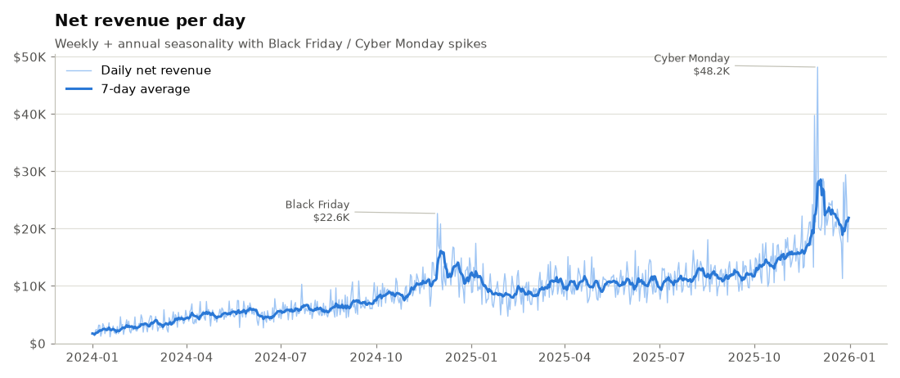
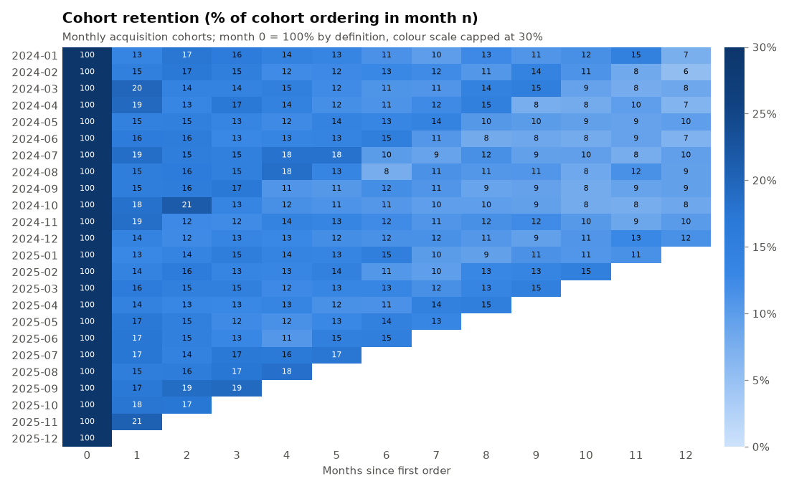
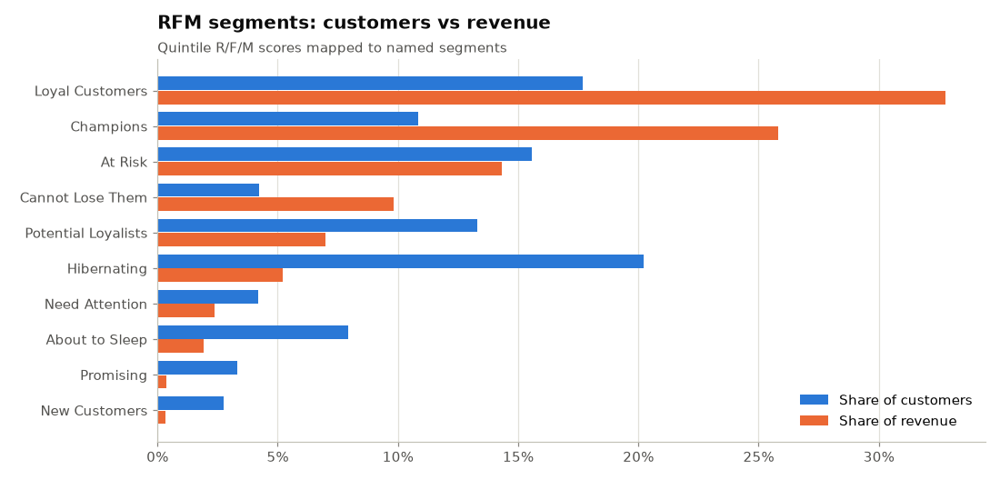
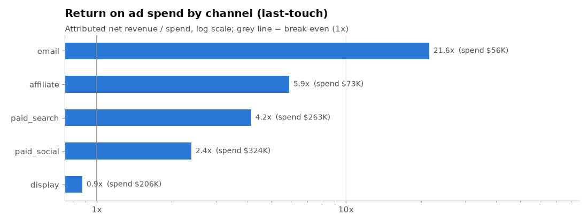
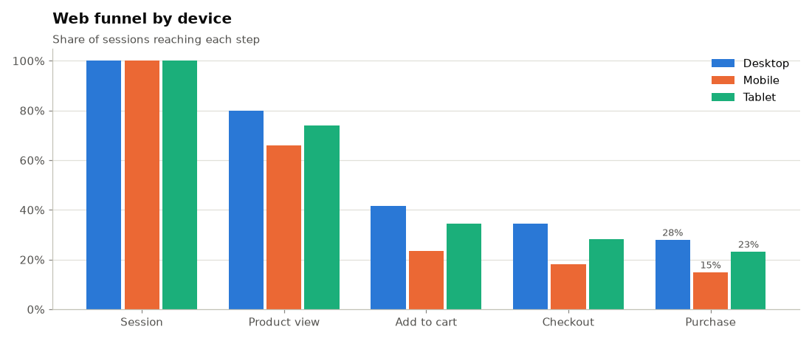
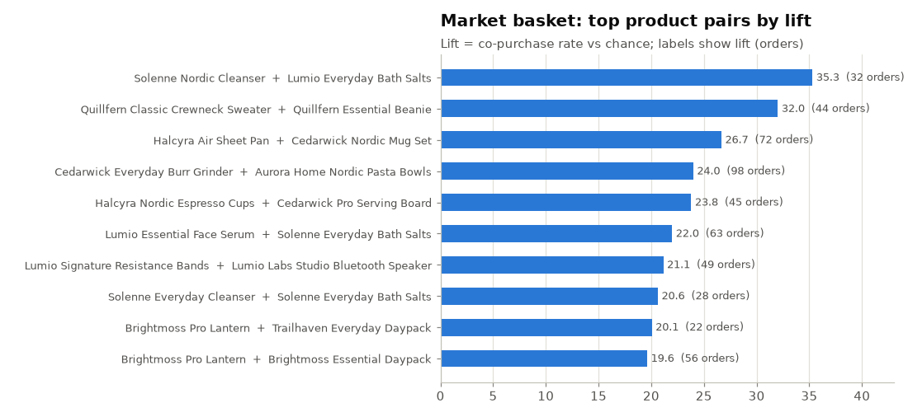
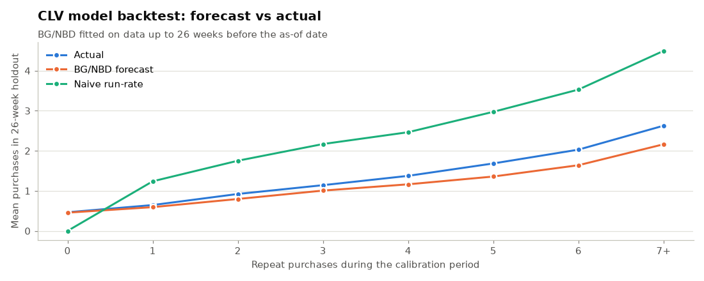
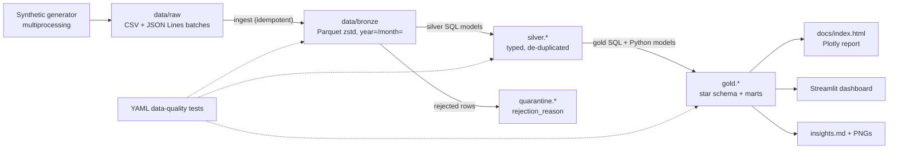
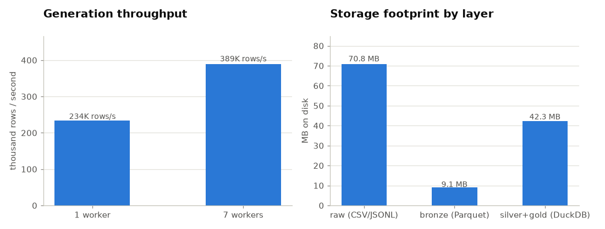

# retail-analytics-lakehouse

[](https://github.com/ADU773/retail-analytics-lakehouse/actions/workflows/ci.yml)
[](https://www.python.org/)
[](LICENSE)

**An end-to-end analytics-engineering platform for a fictional direct-to-consumer retailer,
Aurora Goods Co. - from raw, messy source extracts to an executive dashboard - running as a
laptop-scale lakehouse on DuckDB + Parquet.** A reproducible, multi-process generator lands
~900K rows of realistic e-commerce data (orders, web funnel events, marketing spend) with
~1-2% injected data-quality defects; an idempotent ingestion layer turns it into
Hive-partitioned Parquet; a home-grown mini-dbt DAG runner builds a silver layer (cleaning,
de-duplication, quarantine) and a Kimball star schema with business marts (cohort retention,
RFM, BG/NBD customer lifetime value, market basket, channel ROAS, funnel); declarative YAML
data-quality tests gate every layer; and a `report` command publishes a static Plotly
dashboard plus auto-written insights. One command, about 40 seconds, about 125 MB on disk.

**Live report:** https://adu773.github.io/retail-analytics-lakehouse/ &nbsp;|&nbsp;
[Auto-generated insights](docs/insights.md) &nbsp;|&nbsp; [Architecture](docs/architecture.md)
&nbsp;|&nbsp; [Data dictionary](docs/data_dictionary.md) &nbsp;|&nbsp;
[Data-quality results](docs/data_quality.md)



## Highlights / key results

Every number below was produced by `retail-lakehouse run-all` on the default scale (25,000
customers, 2024-01-01 to 2025-12-31, seed 42) on the development laptop; they are re-written
into this table by `retail-lakehouse report --update-readme`. The data is synthetic, so the
*business* numbers demonstrate the analytics, not a real company.

<!-- KEY_RESULTS:START -->
| Metric | Result |
|---|---|
| Net revenue (2 years, synthetic) | $6.87M from 45,076 orders (YoY +96%) |
| Gross margin / AOV / return rate | 47.2% / $152.51 / 4.9% |
| Cohort retention (share of cohort ordering) | month 1: 16.3%, month 6: 12.1%, month 12: 8.6% |
| Best vs worst paid channel | Email returns 21.6x its spend; display only 0.87x |
| Device conversion gap | Mobile drives 56% of sessions but converts at 15.0% vs 28.1% on desktop |
| CLV backtest (26-week holdout) | -9.7% aggregate error, MAE 0.78 vs 0.95 naive |
| Rows quarantined by silver | 7,350 (0.82% of raw rows) |
| Data-quality tests | 166 tests: 148 pass, 18 warn (bronze), 0 fail |
| End-to-end run-all (default scale) | 43 s; peak RSS 595 MB for the single-process steps, 1,233 MB summed over all 8 processes while generating |
<!-- KEY_RESULTS:END -->

Engineering highlights:

- **Parallel, deterministic generation** - one process per calendar month with per-chunk seeds;
  the landing zone is byte-identical for 1 or N workers (asserted in the test suite).
- **Idempotent bronze ingestion** - sha256 manifest of every landed file; re-running is a
  no-op, a modified landing file is rejected, `--full-refresh` rebuilds.
- **Mini-dbt in ~500 lines** - SQL models with `-- depends_on:` headers, topological sort,
  cycle detection, undeclared-reference detection, `--select +model+`, Python models, quarantine
  splitting and a `meta.run_log` table with per-model rows and timings.
- **Data quality as code** - 166 declarative tests (10 test types, `warn` / `error` severities,
  tolerances) run after every layer, written to JSON + Markdown; error failures exit non-zero.
- **Analytics depth** - SCD Type 2 customer dimension with point-in-time joins, BG/NBD +
  Gamma-Gamma CLV implemented from the papers and back-tested on a 26-week holdout, RFM
  segmentation, product-pair lift, last-touch ROAS / POAS / CAC.

| | |
|---|---|
|  |  |
|  |  |
|  |  |

## Architecture



Bronze keeps raw fidelity (every column `VARCHAR` plus `_ingested_at`, `_source_file`,
`_batch_id`); silver and gold live in a single DuckDB file (`data/warehouse/lakehouse.duckdb`)
that also holds `meta.run_log` and `meta.dq_results`. Details, the layer contract, the DAG
runner and the CLV method are in [docs/architecture.md](docs/architecture.md).

## Tech stack

| Area | Tools |
|---|---|
| Storage / engine | DuckDB 1.x (embedded OLAP), Apache Parquet (zstd) via DuckDB / PyArrow |
| Transformation | SQL models + a custom DAG runner (Kahn topological sort, dbt-style selectors), Jinja for `{{ as_of }}` variables |
| Data generation | NumPy (vectorised, seeded `Generator`s), `multiprocessing` / `concurrent.futures` |
| Modelling | SciPy (BG/NBD and Gamma-Gamma maximum likelihood), pandas |
| Data quality | Declarative YAML -> compiled SQL, JSON + Markdown reports |
| Reporting | Plotly (static HTML, CDN JS), Matplotlib (PNGs), Jinja2 templates, Streamlit |
| Engineering | argparse CLI, `logging`, psutil, pytest (+ Streamlit `AppTest`), ruff, GitHub Actions, Docker |

## How the project uses system resources

The pipeline is sized from the machine it runs on (`src/retail_lakehouse/resources.py`):

- **CPU** - the generator runs `physical cores - 1` worker processes (a `spawn` pool, one task per
  month, largest months scheduled first). Workers load the shared customer / order skeleton from
  a temp pickle in their initializer: passing the ~8 MB state inline made `spawn` block until
  each child had started and read it, so workers came up one after another (profiling showed
  4.1 s of the 7-worker run spent inside `submit`). DuckDB gets one thread per physical core.
- **RAM** - DuckDB `memory_limit` defaults to `min(2 GiB, 25% of total RAM, 50% of available RAM)`
  (floored at 256 MiB) so it stays polite on a shared laptop; peak RSS of every step is measured
  by a background sampler that includes child processes.
- **Storage** - raw text is converted to zstd Parquet once, the warehouse is compacted after each
  full build, and all generated data is gitignored.
- **GPU** - intentionally not used: the workload is columnar SQL over < 1M rows, where a
  vectorised CPU engine wins and a 4 GB laptop GPU would only add transfer overhead.

Measured with `retail-lakehouse benchmark` (numbers written to
[docs/benchmark.json](docs/benchmark.json) and into the tables below by
`retail-lakehouse benchmark --update-readme`):

<!-- BENCHMARK:START -->
Measured on AMD Ryzen 7 6800HS with Radeon Graphics (8 cores / 16 threads, 13.8 GB RAM), Windows 11, Python 3.14.3, DuckDB 1.5.6; 25,000 customers, 2024-01-01 to 2025-12-31.

> Measured on a shared laptop while other workloads kept the CPU ~28% busy, so multi-process and multi-thread speed-ups are understated.

| Generation | Wall time | Throughput | Speed-up | Peak RSS (all processes) |
|---|---:|---:|---:|---:|
| 1 worker | 3.9 s | 233,530 rows/s | 1.00x | 216 MB |
| 7 workers | 2.3 s | 389,054 rows/s | 1.67x | 1,300 MB |

| Pipeline step | Wall time | Peak RSS | CPU time* |
|---|---:|---:|---:|
| generate (into data/raw) | 2.55 s | 1,286 MB | 1.1 s |
| ingest (bronze) | 6.84 s | 565 MB | 10.2 s |
| ingest re-run (idempotent no-op) | 0.32 s | 205 MB | 0.3 s |
| transform silver | 5.07 s | 485 MB | 12.7 s |
| transform gold | 5.16 s | 440 MB | 8.2 s |
| data-quality tests | 3.11 s | 329 MB | 5.3 s |
| compact warehouse | 2.94 s | 608 MB | 8.5 s |

\* user + system CPU of the main process (plus reaped child processes on Linux/macOS); peak RSS is sampled every 50 ms and summed over the process tree.

| DuckDB threads (silver + gold) | Wall time | Speed-up |
|---|---:|---:|
| 1 | 13.13 s | 1.00x |
| 8 | 11.33 s | 1.16x |

| Storage layer | Size on disk |
|---|---:|
| raw (CSV/JSONL) | 70.8 MB |
| bronze (Parquet) | 9.1 MB |
| silver+gold (DuckDB) | 42.3 MB |

Bronze Parquet (zstd) is **7.75x** smaller than the raw landing zone overall and **7.51x** smaller for the CSV entities.
<!-- BENCHMARK:END -->



## Quickstart

Requires Python 3.11+. No external services, no cloud account.

**Windows (PowerShell)**

```powershell
git clone https://github.com/ADU773/retail-analytics-lakehouse.git
cd retail-analytics-lakehouse
python -m venv .venv
.\.venv\Scripts\Activate.ps1
pip install -e ".[dev]"
retail-lakehouse run-all            # ~40 s: generate -> ingest -> transform -> test -> report
streamlit run app/dashboard.py      # interactive dashboard on http://localhost:8501
```

**macOS / Linux**

```bash
git clone https://github.com/ADU773/retail-analytics-lakehouse.git
cd retail-analytics-lakehouse
python -m venv .venv
source .venv/bin/activate
pip install -e ".[dev]"
retail-lakehouse run-all            # or: make run-all
streamlit run app/dashboard.py      # or: make dashboard
```

Smaller runs: `retail-lakehouse run-all --scale tiny` (600 customers, one year, ~12 s) or any
combination of `--customers`, `--start/--end`, `--days`, `--seed` and `--workers`.
`python -m retail_lakehouse ...` works everywhere the console script does.

**Docker**

```bash
docker build -t retail-lakehouse .
docker run --rm retail-lakehouse                                   # run-all --scale small
docker run --rm -p 8501:8501 retail-lakehouse sh -c \
  "retail-lakehouse run-all --scale small && streamlit run app/dashboard.py --server.address=0.0.0.0"
```

## CLI reference

```text
retail-lakehouse [global options] <command> [command options]

global:  --config FILE  --data-dir DIR  --reports-dir DIR  --docs-dir DIR
         --threads N  --memory-limit 1GB  --as-of YYYY-MM-DD  --log-level LEVEL
```

| Command | What it does | Useful options |
|---|---|---|
| `generate` | Synthetic raw data -> `data/raw/<entity>/<batch>/` (CSV / JSON Lines) | `--scale tiny\|small\|default`, `--customers`, `--start`, `--end`, `--days`, `--seed`, `--workers` |
| `ingest` | Raw -> bronze Parquet with lineage columns; skips files already in the manifest | `--full-refresh` |
| `transform` | Runs silver + gold models in dependency order, logs to `meta.run_log` | `--select +gold.mart_rfm silver.orders+ 'gold.mart_*'`, `--layer silver` |
| `test` | Declarative data-quality tests; exit code 1 on any error-severity failure | `--layer bronze`, `--no-fail` |
| `report` | `docs/index.html`, `docs/images/*.png`, `docs/insights.md`, data dictionary, DQ page | `--update-readme` |
| `run-all` | generate -> ingest -> test -> silver -> test -> gold -> test -> compact -> report | generator options, `--skip-report`, `--update-readme` |
| `benchmark` | Generation throughput (1 vs N workers, best of `--repeats`), per-step wall time / peak RSS, DuckDB thread scaling, Parquet compression ratio, storage per layer | `--workers-list 1,4,7`, `--repeats 3`, `--update-readme` |
| `lineage` | Prints the model DAG as text or Mermaid | `--format mermaid`, `--select` |
| `clean` | Deletes `data/` and `reports/` (never `docs/`) | `--keep-raw` |

Configuration is layered: package defaults (`src/retail_lakehouse/defaults/default.yaml`) <
`--scale` preset < `lakehouse.yaml` (see [lakehouse.example.yaml](lakehouse.example.yaml)) or
`--config` < environment variables `RLH__<SECTION>__<KEY>` (e.g. `RLH__GENERATOR__CUSTOMERS=5000`)
< CLI flags.

## Project structure

```text
retail-analytics-lakehouse/
|-- app/dashboard.py                 Streamlit dashboard (date / region / channel filters)
|-- docs/                            published report (GitHub Pages) + architecture & data docs
|   |-- index.html  insights.md  data_dictionary.md  data_quality.md  architecture.md
|   |-- benchmark.json  metrics.json  images/*.png
|-- src/retail_lakehouse/
|   |-- cli.py  __main__.py  config.py  pipeline.py  benchmark.py  resources.py  warehouse.py
|   |-- defaults/default.yaml        package defaults + scale presets
|   |-- generator/                   calendar, catalog, customers, behaviour, DQ injection, chunked writer
|   |-- bronze/                      contracts, idempotent ingest, sha256 manifest
|   |-- sql/macros.sql               shared DuckDB macros (timestamp parsing, e-mail cleaning, ...)
|   |-- sql/silver/*.sql             8 silver models (+ quarantine)
|   |-- sql/gold/*.sql               13 gold SQL models (dims, facts, marts)
|   |-- transform/                   model parsing, DAG, runner, Python models, BG/NBD + Gamma-Gamma
|   |-- dq/{bronze,silver,gold}.yaml declarative data-quality tests
|   |-- quality/                     spec parser, SQL compiler, runner + reports
|   |-- reporting/                   report data, Plotly figures, PNGs, insights, dashboard queries
|   `-- templates/report.html.j2
|-- tests/                           unit + end-to-end + dashboard (AppTest) tests
|-- .github/workflows/ci.yml  Dockerfile  Makefile  pyproject.toml  lakehouse.example.yaml
```

## Data model

Generated source entities (landing zone): `customers` (JSONL, sign-ups + CDC snapshots),
`products` (CSV), `orders`, `order_items`, `returns` (CSV), `web_sessions`, `web_events`
(JSONL), `marketing_spend` (CSV).

| Gold table | Grain | Notes |
|---|---|---|
| `dim_date` | one row per day | weekday/weekend, Black Friday, Cyber Monday, holidays, peak season |
| `dim_customer` | one row per customer **version** | SCD Type 2 on segment / region / country / city (`valid_from`, `valid_to`, `is_current`); Type 1 for contact fields; unknown member |
| `dim_product` | one row per product | category > subcategory, brand, list price, unit cost, list margin |
| `fact_orders` | one row per order | point-in-time `customer_key`, revenue, discount, COGS, margin, returns, last-touch channel, device, order sequence |
| `fact_order_items` | one row per order line | quantity, net amount, margin, returned quantity and reason |
| `fact_sessions` | one row per web session | deepest funnel step, events, linked order |
| `mart_daily_kpis` | one row per day | revenue, orders, AOV, units, gross margin %, return rate, conversion rate, new customers, spend, MER |
| `mart_cohort_retention` | cohort month x months since first order | active customers, retention rate, cumulative revenue per customer |
| `mart_rfm` | one row per purchasing customer | R/F/M quintile scores and named segment (Champions, Loyal Customers, At Risk, Hibernating, ...) |
| `mart_customer_ltv` | one row per purchasing customer | historical CLV, P(alive), expected purchases, predicted 12-month CLV, CLV tier |
| `mart_clv_backtest` | one row per customer in calibration | predicted vs actual 26-week holdout purchases, naive baseline |
| `mart_market_basket` | one row per product pair | support, confidence (both directions), lift |
| `mart_channel_roas` | month x channel | spend, clicks, attributed orders / revenue / margin, ROAS, POAS, CAC, CPC |
| `mart_funnel` | month x device x traffic source x region | sessions at each step and step conversion rates |
| `mart_quarantine_summary` | entity x rejection reason | rejected rows and share of bronze rows |

Every column is documented in [docs/data_dictionary.md](docs/data_dictionary.md), generated
from the descriptions in the YAML test specs.

## Testing

```bash
pytest -q                 # unit + end-to-end + dashboard tests (~45 s locally)
ruff check . && ruff format --check .
```

- **Unit** - configuration layering and validation, DAG parsing / ordering / cycles / selectors,
  every data-quality test type against a hand-built table, BG/NBD parameter recovery on
  simulated data, Gamma-Gamma shrinkage, DQ injectors, retail calendar, resource helpers.
- **Integration** - generator determinism across worker counts, landing-zone contracts, bronze
  idempotency, zstd + Hive partitioning, changed-file rejection, benchmark + clean.
- **End-to-end** - a tiny-scale `run-all` in a temp directory: every model built and logged, SCD2
  invariants, revenue reconciliation between marts and facts, quarantine contents, `--select`
  subgraphs, CLI exit codes on DQ failure, report artifacts (and that no local paths leak into
  them), plus the Streamlit app run headless through `streamlit.testing.v1.AppTest`.

Tests never touch the network or previously generated data.

## CI/CD

[`.github/workflows/ci.yml`](.github/workflows/ci.yml) runs on every push and pull request:

1. **lint** - `ruff check` and `ruff format --check`;
2. **test** - Python 3.11 and 3.12 matrix with pip caching: `pip install -e ".[dev]"`, pytest
   with coverage, then a CLI smoke run at tiny scale;
3. **docker** - builds the image and runs `retail-lakehouse --version` inside it.

The static report in `docs/` is served by GitHub Pages.

## Design decisions and trade-offs

- **DuckDB + Parquet instead of Spark / a warehouse** - the data fits on one machine, so an
  embedded vectorised engine gives warehouse semantics (window functions, `QUALIFY`, `COPY`)
  with zero infrastructure. Parquet keeps bronze engine-agnostic.
- **Bronze as all-`VARCHAR`** - nothing is lost or coerced at ingestion; typing errors become
  explicit, auditable quarantine reasons in silver instead of silent ingestion failures.
- **Quarantine, never drop** - every rejected row is kept with a reason, so row counts reconcile
  from raw to silver and the DQ story is measurable.
- **A custom DAG runner instead of dbt** - shows the mechanics (dependency resolution, selection,
  run logging) in a few hundred readable lines and avoids a heavyweight dependency; the SQL
  files use dbt-like conventions so migrating to dbt-duckdb would be mechanical.
- **Full rebuilds of silver / gold** - simpler and fast enough at this scale (about 10 s for all 23 models); an
  incremental strategy is on the roadmap.
- **Last-touch attribution** - transparent and reproducible, but it under-credits upper-funnel
  channels (called out in the insights).
- **BG/NBD + Gamma-Gamma** - interpretable, well-established probabilistic CLV models that need
  only RFM summaries; validated out-of-time against a naive baseline rather than assumed.
- **Synthetic data** - lets the project ship realistic defects and seasonality without privacy
  concerns; all names and brands are fictional.

## Roadmap

- Incremental silver / gold models (merge on changed partitions) and partition pruning in bronze.
- Multi-touch / data-driven attribution alongside last touch.
- Data contracts with schema-evolution handling in bronze (new / renamed columns).
- Orchestration example (e.g. a scheduled GitHub Action that refreshes the Pages report).
- Optional export of gold to MotherDuck / Postgres for BI tools.

## License

[MIT](LICENSE) - Copyright (c) 2026 Advaith A Arun.
