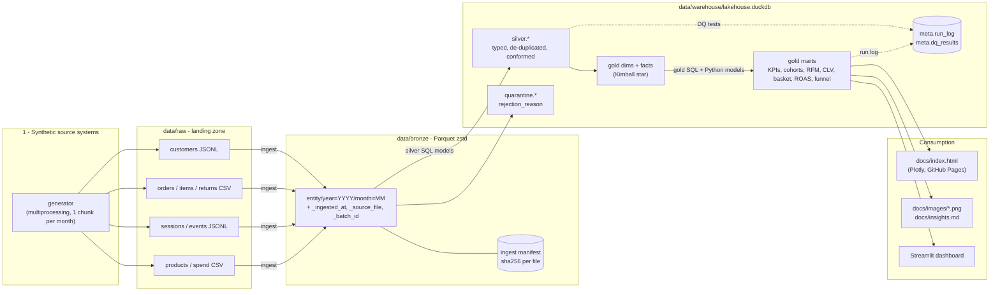

# Architecture

`retail-analytics-lakehouse` is a single-node lakehouse: open file formats (CSV / JSON Lines
in, Parquet in the middle) plus an embedded analytical engine (DuckDB). Everything runs from
one CLI on a laptop or in CI, with no servers to operate.



## Layers

| Layer | Storage | Responsibility | Code |
|---|---|---|---|
| Raw | `data/raw/<entity>/<batch>/*.csv / *.jsonl` | Immutable landing zone exactly as "source systems" delivered it, warts and all. One batch per month plus late-arriving batches. | `generator/` |
| Bronze | `data/bronze/<entity>/year=/month=/*.parquet` (zstd) | Raw fidelity (every column `VARCHAR`), Hive partitions, lineage columns, append-only and idempotent through a sha256 manifest. | `bronze/` |
| Silver | `silver.*`, `quarantine.*` tables in DuckDB | Type casting, trimming / case-folding, timestamp normalisation to UTC, de-duplication with window functions, FK validation. Every rejected row lands in `quarantine.<entity>` with a `rejection_reason`. | `sql/silver/*.sql` |
| Gold | `gold.*` tables in DuckDB | Kimball star schema (`dim_date`, `dim_customer` SCD2, `dim_product`, `fact_orders`, `fact_order_items`, `fact_sessions`) and business marts. | `sql/gold/*.sql`, `transform/python_models.py` |
| Meta | `meta.*` | `run_log` (per-model status, rows, seconds), `dq_results`, `model_params` (fitted CLV parameters). | `transform/runner.py`, `quality/runner.py` |

## Mini-dbt DAG runner

* Each model is a `.sql` file whose header declares metadata:

  ```sql
  -- description: Order headers normalised to UTC, de-duplicated to the latest CDC version
  -- depends_on: bronze.orders, silver.customers
  -- quarantine: quarantine.orders
  ```

* The runner discovers models, builds a graph, checks that every `schema.table` referenced in
  the SQL is declared in `depends_on` (catches missing edges), orders it with Kahn's algorithm
  (deterministic layer/name tie-break) and reports cycles as `a -> b -> c -> a`.
* `--select` supports `model`, `+model` (with upstream), `model+` (with downstream), `+model+`
  and globs such as `gold.mart_*`.
* Models with a `quarantine:` header emit a `rejection_reason` column; the runner splits the
  result into the clean table and the quarantine table in one pass.
* Python models (`@python_model`) are first-class DAG nodes - used for the CLV model, which
  needs numerical optimisation (scipy) rather than SQL.
* Every execution is appended to `meta.run_log` (run id, model, status, rows, quarantined rows,
  seconds). A failed model marks its downstream models as `skipped` and the CLI exits non-zero.

## Data-quality framework

Declarative YAML per layer (`src/retail_lakehouse/dq/<layer>.yaml`), modelled on dbt's
`schema.yml`. Supported tests: `not_null`, `unique`, `unique_combination`, `accepted_values`,
`relationships`, `range`, `expression`, `row_count_min`, `freshness` and raw `sql`. Each test
has a `severity` (`warn` / `error`) and optional tolerances (`max_failures`,
`max_failure_rate`) and `where` filters. Tests compile to a single `SELECT failures, total`
query each. Results go to `meta.dq_results`, `reports/dq/*.json|md`; any error-severity
failure raises and the CLI returns exit code 1.

Bronze tests are deliberately `warn`: they *measure* the injected problems. Silver and gold
tests are `error`: they assert the problems were fixed.

## Parallelism and resources

* **Generator** - the parent process builds the global "skeleton" (product catalog, customer
  base, order timestamps) with seeded numpy generators, then fans out one task per calendar
  month to a `spawn` process pool. Each chunk derives its own seed from `(seed, chunk index)`,
  so the output is byte-identical for any worker count (asserted by a test).
  The shared state is handed to workers as a temp-file pickle path rather than inline, so
  process start-up is not serialised behind the parent's pipe writes.
* **DuckDB** - `threads` defaults to the number of physical cores and `memory_limit` to
  `min(2 GiB, 25% of total RAM, 50% of available RAM)`, floored at 256 MiB; spills go to
  `data/warehouse/tmp`.
* **Compaction** - DuckDB re-uses but never returns space freed by `CREATE OR REPLACE`, so
  `run-all` and `benchmark` finish with a `COPY FROM DATABASE` compaction of the warehouse.
* **GPU** - not used. The workload is columnar SQL over < 1M rows, where a vectorised CPU engine
  is the right tool; shipping data to a 4 GB laptop GPU would cost more than it saves.

## CLV method (gold.mart_customer_ltv)

* **Historical CLV** - gross margin (net revenue - COGS) to date per customer.
* **Predicted 12-month CLV** = `E[purchases in next 52 weeks]` x `E[order value]` x
  `customer margin rate`, where
  * purchases follow a **BG/NBD** model (Fader, Hardie & Lee 2005) fitted by maximum likelihood
    on each customer's repeat-purchase frequency `x`, recency `t_x` and age `T` (weeks);
  * order value follows a **Gamma-Gamma** model that shrinks each customer's average repeat
    order value towards the population mean;
  * the margin rate is the customer's historical gross-margin share (clipped to [0, 0.9]).
* **Validation** - `gold.mart_clv_backtest` refits the model on data up to 26 weeks before the
  as-of date and compares predicted vs actual purchases in the 26-week holdout, alongside a naive
  run-rate baseline. Both models are implemented from the published likelihoods with
  numpy/scipy (no CLV library dependency) and unit-tested by parameter recovery on simulated
  data.

## Injected data-quality problems

| Problem | Where | How silver handles it |
|---|---|---|
| Exact duplicate rows (re-delivered records) | all entities | `row_number()` window de-dup; extra copies quarantined as `duplicate_record` |
| CDC versions of the same key | customers, orders | keep latest `updated_at`; customer versions feed SCD2 |
| Null / invalid e-mails | customers | `clean_email()` macro normalises; invalid addresses are flagged `is_email_valid = false` (the customer is kept, not dropped) |
| Zero / negative quantities | order items | quarantined (`non_positive_quantity`) |
| Mixed case / padded categoricals | device, status, segment, category, ... | `lower(trim())` + accepted-values mapping |
| Inconsistent timestamp formats and time zones | orders, events, sessions | multi-format parser macro -> UTC `TIMESTAMP`; original format kept for audit |
| Late-arriving records | orders, events | delivered in a later batch; flagged `is_late_arriving` |
| Orphan foreign keys | orders, items, returns, sessions, events | quarantined (`orphan_customer_id`, `orphan_product_id`, `orphan_session_id`, ...); lines of a quarantined order follow it (`parent_order_quarantined`) |
| Negative spend adjustments | marketing spend | quarantined (`negative_spend`) |
